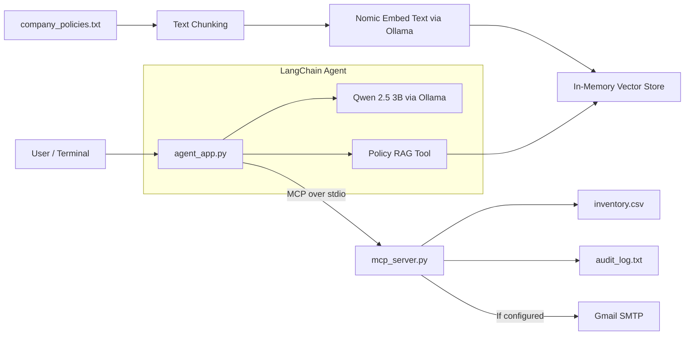

# Agentic Inventory Auditor

This project demonstrates an agentic inventory audit using a local LLM, retrieval-augmented generation (RAG), LangChain tools, and the Model Context Protocol (MCP).

The application reads inventory data and company policy, asks a local LLM to decide what action each SKU requires, and performs allowed operations through an MCP server.

## Architecture



### Component Responsibilities

- `agent_app.py` creates the LangChain agent and runs the complete inventory audit.
- `qwen2.5:3b` served by Ollama selects tools and follows the system prompt.
- `company_policies.txt` contains the warehouse stock and escalation rules.
- Policy text is split into overlapping chunks, embedded with `nomic-embed-text`, and stored in memory for semantic retrieval.
- `mcp_server.py` exposes inventory and notification operations as FastMCP tools.
- `inventory.csv` is the source of product IDs and stock counts.
- `audit_log.txt` records team alerts and simulated or actual escalation email actions.
- The MCP server communicates with the agent application through standard input/output (`stdio`).

### Audit Flow

1. The agent receives the request to audit every inventory SKU.
2. The agent retrieves the relevant rules from `company_policies.txt` once.
3. The agent calls `get_all_inventory` once to load the CSV and classify each SKU.
4. The stock status determines the action:
   - `OUT OF STOCK` - call `send_escalation_email`
   - `LOW STOCK` - call `send_team_alert`
   - `HEALTHY STOCK` - take no action
5. Intermediate tool calls and results are printed to the terminal.
6. The final audit summary is returned by the agent.

## Prerequisites

- Windows PowerShell
- Python 3.10 or newer
- [Ollama](https://ollama.com/) installed and running
- The following Ollama models:
  - `qwen2.5:3b`
  - `nomic-embed-text`

Pull the required models with:

```powershell
ollama pull qwen2.5:3b
ollama pull nomic-embed-text
```

Verify that Ollama is running:

```powershell
ollama list
```

## Run Locally

Open PowerShell in the project directory.

### 1. Create a Virtual Environment

```powershell
python -m venv venv
```

### 2. Activate the Virtual Environment

```powershell
.\venv\Scripts\Activate.ps1
```

If PowerShell blocks activation scripts, you can run:

```powershell
Set-ExecutionPolicy -Scope Process -ExecutionPolicy Bypass
.\venv\Scripts\Activate.ps1
```

### 3. Install Dependencies

```powershell
python -m pip install --upgrade pip
python -m pip install langchain langchain-ollama langchain-core langchain-text-splitters langchain-mcp-adapters mcp
```

### 4. Start Ollama

Open Ollama from the Start menu or run:

```powershell
ollama serve
```

Keep this process running in a separate terminal.

### 5. Run the Audit

```powershell
python agent_app.py
```

The program starts `mcp_server.py` as a child process, performs the policy-guided audit, and prints agent actions, tool results, and the final summary.

## Optional Gmail Escalation

By default, when no SMTP credentials are available, an escalation email is simulated and written to `audit_log.txt`.

To enable the email attempt, set these environment variables in PowerShell before running the application:

```powershell
$env:GMAIL_USER = "your-address@gmail.com"
$env:GMAIL_APP_PASSWORD = "your-gmail-app-password"
$env:ESCALATION_RECIPIENT = "operations-team@example.com"
python agent_app.py
```

`ESCALATION_RECIPIENT` is optional. If omitted, the value of `GMAIL_USER` is used.

Do not commit Gmail passwords or app passwords to source control.

## Project Files

| File | Purpose |
| --- | --- |
| `agent_app.py` | LangChain agent, local LLM configuration, RAG setup, and audit loop |
| `mcp_server.py` | FastMCP inventory, alert, and escalation tools |
| `company_policies.txt` | Warehouse policy used by RAG retrieval |
| `inventory.csv` | Product inventory input |
| `audit_log.txt` | Timestamped alert and escalation history |
| `venv/` | Local Python virtual environment |

## Troubleshooting

- **Ollama connection fails:** Confirm `ollama serve` is running and port `11434` is available.
- **Model not found:** Run `ollama pull qwen2.5:3b` and `ollama pull nomic-embed-text`.
- **MCP server cannot start:** Run `python mcp_server.py` once to verify the server can initialize.
- **No SMTP credentials:** The escalation is intentionally logged as simulated instead of being sent.
- **CSV or policy file changes are not reflected:** Restart `agent_app.py`; policy chunks and RAG data are rebuilt at startup.
